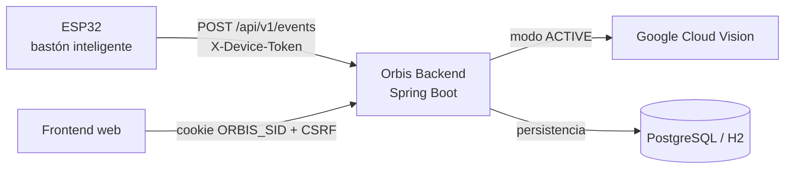

<div align="center">

# 🦯 Orbis Backend

**API REST de Orbis: tecnología asistiva IoT para personas con discapacidad visual (bastón inteligente con IA).**


</div>

> [!NOTE]
> Este repositorio es el **backend** del proyecto Orbis.
> El frontend está en [orbisFrontend](https://github.com/JuanAcostaACE/orbisFrontend).

## 📑 Contenido

- [Descripción](#-descripción)
- [Arquitectura](#-arquitectura)
- [Stack](#-stack)
- [Patrones de diseño](#-patrones-de-diseño)
- [Endpoints](#-endpoints)
- [Inicio rápido (local)](#-inicio-rápido-local)
- [Prueba rápida (sin hardware)](#-prueba-rápida-sin-hardware)
- [Variables de entorno](#-variables-de-entorno)
- [Base de datos](#-base-de-datos)
- [Google Cloud Vision](#-google-cloud-vision-solo-modo-active)
- [Despliegue en Railway](#-despliegue-en-railway)
- [Estructura del proyecto](#-estructura-del-proyecto)
- [Seguridad](#-seguridad)
- [Parte del proyecto Orbis](#-parte-del-proyecto-orbis)

---

## 📖 Descripción

Orbis Backend es una API REST construida con **Java 21** y **Spring Boot 4.1.1**. Recibe eventos del hardware **ESP32** (el bastón inteligente), analiza imágenes con **Google Cloud Vision API** y persiste los eventos en **PostgreSQL**. Expone endpoints REST que consume el frontend web.

## 🧭 Arquitectura



## 🧰 Stack

| Capa | Tecnología |
|---|---|
| Lenguaje | Java 21 |
| Framework | Spring Boot 4.1.1 |
| Base de datos | PostgreSQL (producción) / H2 en memoria (desarrollo local) |
| IA | Google Cloud Vision API |
| Deploy | Railway |
| Hardware | ESP32 (firmware en `hardware/wokwi/`) |

## 🧩 Patrones de diseño

| Patrón | Descripción |
|---|---|
| **Strategy** | Selección dinámica del modo de procesamiento (`PASSIVE` / `ACTIVE`) |
| **Factory Method** | Creación desacoplada de strategies |
| **Facade / Adapter** | Aislamiento de Google Cloud Vision |
| **Observer** | Notificación de eventos sin acoplamiento |
| **State** | Gestión de estados del sistema (Inactivo → Pasivo → Activo) |
| **Command** | Encapsulamiento de operaciones (guardar evento, consultar IA) |

## 🔌 Endpoints

| Método | URL | Descripción |
|---|---|---|
| `POST` | `/api/v1/events` | Recibe evento del ESP32 (con `X-Device-Token`) o de una sesión de usuario |
| `GET` | `/api/v1/events` | Lista todos los eventos |
| `GET` | `/api/v1/events/{id}` | Obtiene un evento por ID |
| `GET` | `/api/v1/events/status` | Estado actual del sistema (State pattern) |
| `GET` | `/health` | Health check |
| `POST` | `/auth/login` | Inicio de sesión (limitado por IP y por cuenta, responde `429` al superarlo) |
| `POST` | `/auth/register` | Registro (limitado por IP, responde `429` al superarlo) |

---

## 🚀 Inicio rápido (local)

### Requisitos

- Java 21 instalado y configurado en `JAVA_HOME`.
- (Opcional) Maven 3.x, o usar el `mvnw` incluido.

### Pasos

```bash
# 1. Clonar el repositorio
git clone https://github.com/JuanAcostaACE/orbisBackend.git
cd orbisBackend

# 2. Ejecutar (usa H2 en memoria automáticamente, sin configurar la base de datos)
.\mvnw.cmd spring-boot:run       # Windows
./mvnw spring-boot:run           # Linux/macOS

# 3. API disponible en:
# http://localhost:8080/api/v1/events
```

No se requiere ninguna variable de entorno para arrancar en local: el esquema se crea solo con H2 en memoria.

### Consola H2 (solo desarrollo explícito)

La consola H2 (`/h2-console`) está **desactivada** en el perfil por defecto. Solo se activa con el perfil `dev` y la variable `H2_CONSOLE_ENABLED=true`:

```bash
SPRING_PROFILES_ACTIVE=dev H2_CONSOLE_ENABLED=true ./mvnw spring-boot:run
# Consola: http://localhost:8080/h2-console
```

En `prod` la consola siempre está desactivada. La base H2 en memoria sigue siendo el almacenamiento local por defecto.

### Ejecutar las pruebas

```bash
./mvnw test
```

En Windows, usa `.\mvnw.cmd test`.

---

## 🧪 Prueba rápida (sin hardware)

```bash
# Modo PASSIVE: simula obstáculo detectado
curl -X POST http://localhost:8080/api/v1/events \
  -H "Content-Type: application/json" \
  -H "X-Device-Token: $APP_DEVICE_TOKEN" \
  -d '{"mode":"PASSIVE","distanceCm":28.5}'

# Modo ACTIVE: simula análisis de IA
curl -X POST http://localhost:8080/api/v1/events \
  -H "Content-Type: application/json" \
  -H "X-Device-Token: $APP_DEVICE_TOKEN" \
  -d '{"mode":"ACTIVE","distanceCm":28.5}'

# Listar todos los eventos
curl http://localhost:8080/api/v1/events

# Estado del sistema
curl http://localhost:8080/api/v1/events/status
```

> [!IMPORTANT]
> Sin un `X-Device-Token` válido, `POST /api/v1/events` solo acepta una sesión de usuario y responde `401`.
> Para probar con `curl` en local, define `APP_DEVICE_TOKEN` y `APP_DEVICE_OWNER_EMAIL` antes de arrancar
> (ver [Autenticación de dispositivo](#autenticación-de-dispositivo-esp32)). Si los `GET` responden `401`,
> inicia sesión primero.

---

## ⚙️ Variables de entorno

### Producción (Railway + PostgreSQL)

| Variable | Descripción | Ejemplo |
|---|---|---|
| `DB_URL` | JDBC URL de PostgreSQL | `jdbc:postgresql://host:5432/railway` |
| `DB_USERNAME` | Usuario de la base de datos | `postgres` |
| `DB_PASSWORD` | Contraseña de la base de datos | `tu-password` |
| `SPRING_PROFILES_ACTIVE` | Perfil Spring activo | `prod` |
| `GOOGLE_APPLICATION_CREDENTIALS` | Ruta al JSON de la cuenta de servicio de GCP | `/app/gcp-key.json` |
| `PORT` | Puerto HTTP (Railway lo inyecta automáticamente) | `8080` |
| `APP_CORS_ORIGIN` | URL exacta del frontend (sin `/` final) | `https://orbis.vercel.app` |
| `APP_DEVICE_TOKEN` | Token del ESP32 (32+ caracteres aleatorios) | — |
| `APP_DEVICE_OWNER_EMAIL` | Correo del dueño del dispositivo | `correo@ejemplo.com` |
| `SESSION_COOKIE_SECURE` | Cookie solo por HTTPS (en `prod` ya es `true`) | `true` |
| `SHOW_SQL` | Imprimir SQL en el log (solo depuración) | `false` |

### Autenticación de dispositivo (ESP32)

| Variable | Descripción |
|---|---|
| `APP_DEVICE_TOKEN` | Token que el ESP32 envía en la cabecera `X-Device-Token`. |
| `APP_DEVICE_OWNER_EMAIL` | Correo del usuario propietario de los eventos del dispositivo. Obligatorio si `APP_DEVICE_TOKEN` está definido; debe tener formato de correo válido y pertenecer a un usuario registrado. |

**Regla de arranque.** Si `APP_DEVICE_TOKEN` está definido, `APP_DEVICE_OWNER_EMAIL` también debe estarlo y tener formato de correo válido. Si falta o es inválido, la aplicación no arranca y el mensaje de error nombra la variable (nunca muestra valores).

**Si `APP_DEVICE_TOKEN` está vacío o no definido.** La autenticación de dispositivo queda deshabilitada y el arranque no falla. Si `APP_DEVICE_OWNER_EMAIL` está definido, se registra un aviso (`WARN`) porque no tiene efecto. El filtro no autentica ninguna petición con `X-Device-Token`. Sin token válido, `POST /api/v1/events` solo acepta una sesión de usuario y el ESP32 recibirá `401`. Verifica que la variable esté definida en cada entorno.

**Propietario no registrado.** Si el correo de `APP_DEVICE_OWNER_EMAIL` no corresponde a un usuario registrado, una petición del dispositivo responde `404` con un mensaje genérico y se registra un error en el log (sin el correo ni el token).

### Limitador de peticiones (login y registro)

`POST /auth/login` y `POST /auth/register` tienen un límite por IP con ventana fija (en memoria). Al superarlo responden **429** con `{status, message, timestamp}` y la cabecera `Retry-After`.

| Variable | Por defecto | Descripción |
|---|---|---|
| `APP_RATELIMIT_ENABLED` | `true` | Activa o desactiva el limitador |
| `APP_RATELIMIT_LOGIN_MAX` | `10` | Intentos de login permitidos por ventana |
| `APP_RATELIMIT_LOGIN_WINDOW` | `60` | Duración de la ventana de login (segundos) |
| `APP_RATELIMIT_REGISTER_MAX` | `10` | Registros permitidos por ventana |
| `APP_RATELIMIT_REGISTER_WINDOW` | `3600` | Duración de la ventana de registro (segundos) |
| `APP_RATELIMIT_ACCOUNT_MAX` | `5` | Intentos fallidos de login por cuenta (correo normalizado) antes de bloquearla |
| `APP_RATELIMIT_ACCOUNT_WINDOW` | `900` | Ventana del bloqueo por cuenta (segundos). La cuenta queda bloqueada hasta que caduque |

<details>
<summary><b>Cliente real detrás del proxy (<code>X-Real-IP</code>)</b></summary>

<br>

Detrás de un proxy, la conexión directa llega desde el proxy y no desde el cliente. Tomcat (`RemoteIpValve`, bloque `server.tomcat.remoteip` en `application.yaml`) toma el cliente real de la cabecera `X-Real-IP` **solo** si la conexión directa viene de un proxy de confianza.

- `X-Forwarded-For` **no** se usa: un cliente puede falsificarla sin un proxy de confianza.
- Una `X-Real-IP` enviada por un par no confiable se ignora.

| Variable | Por defecto | Descripción |
|---|---|---|
| `APP_TRUSTED_PROXIES` | Loopback y rangos privados (`127.x`, `::1`, `10.x`, `172.16-31.x`, `192.168.x`, IPv6 ULA `fc00::/7`) | Expresión regular con las IP de conexión de confianza. No usar llaves en el valor. Vacía = no se confía en ningún proxy |

> [!WARNING]
> **Verificación pendiente (operador).** Desde el repositorio no se pudo confirmar la IP desde la que Railway conecta con el contenedor. Railway no publica rangos fijos para su proxy, y hay reportes de IPs en `100.64.0.0/10` (espacio CGNAT) que **no** están en el valor por defecto. Si la IP del proxy no entra en el patrón, `X-Real-IP` se ignora y el límite vuelve a ser global (el comportamiento anterior, sin riesgo de suplantación).
>
> Para confirmarlo tras desplegar: envía `X-Real-IP: 203.0.113.99` a `POST /auth/login` con credenciales erróneas repetidas y revisa en los logs la IP que aparece en el aviso "Límite de peticiones alcanzado". Si aparece la IP del proxy y no `203.0.113.99`, añade esa IP con `APP_TRUSTED_PROXIES`.

Además, el tráfico por la red privada de Railway (`*.railway.internal`) no pasa por el edge, así que cualquier servicio dentro del patrón de confianza podría fijar `X-Real-IP`. Confiar en el patrón por defecto solo es seguro si este backend es el único servicio de su entorno con acceso a la red privada.

</details>

<details>
<summary><b>Límite por cuenta (login)</b></summary>

<br>

Además del límite por IP, `POST /auth/login` cuenta los intentos fallidos por correo normalizado (minúsculas y sin espacios). Al alcanzar `APP_RATELIMIT_ACCOUNT_MAX` fallos dentro de `APP_RATELIMIT_ACCOUNT_WINDOW` segundos, la cuenta responde **429** con el mismo cuerpo que el límite por IP, aunque se envíe la contraseña correcta.

- La comprobación se hace antes de buscar el usuario, así que una cuenta bloqueada y una inexistente responden igual.
- Un login correcto borra el contador.
- Una IP no bloquea a otras cuentas; una cuenta bloqueada lo está desde cualquier IP.

> [!NOTE]
> Efecto colateral conocido: quien conoce un correo puede bloquear temporalmente el acceso de esa cuenta enviando intentos erróneos (denegación de servicio por cuenta).

</details>

<details>
<summary><b>Limitaciones y riesgo abierto (instancia única)</b></summary>

<br>

- **Estos contadores funcionan para UNA sola instancia del backend.** Los contadores de IP y de cuenta viven en la memoria del proceso. Si el backend corre en más de una instancia, cada una cuenta por separado y los límites se multiplican por el número de instancias.
- Si el backend pasa a varias instancias, los contadores deben moverse a un almacén compartido (por ejemplo, el PostgreSQL existente). Esa decisión requiere aprobación del propietario; no se añadió Redis ni otra dependencia de infraestructura.
- Sin persistencia entre reinicios: al reiniciar el proceso los contadores se pierden.

</details>

---

## 🗄️ Base de datos

### Local (H2, automático)

Sin configuración. El esquema se crea automáticamente al iniciar.

### Producción (PostgreSQL en Railway)

1. Crea un proyecto en [Railway](https://railway.app).
2. Agrega un servicio PostgreSQL.
3. Configura las [variables de entorno](#producción-railway--postgresql).
4. Ejecuta los scripts SQL en este orden:
   - `src/main/resources/schema-postgresql.sql`
   - `src/main/resources/data-postgresql.sql`

> [!WARNING]
> **Base existente con nombres en español** (`usuarios`, `registro_eventos`, `tipo_obstaculo`): antes de desplegar esta versión, haz un backup y ejecuta **una vez** `src/main/resources/migration-english-names.sql`.
>
> Renombra tablas y columnas y traduce los valores (`PASIVO`/`ACTIVO` → `PASSIVE`/`ACTIVE`, `ALTO`/`MEDIO`/`BAJO` → `HIGH`/`MEDIUM`/`LOW`) sin borrar filas. Si el backend nuevo arranca antes, Hibernate crea tablas vacías con los nombres nuevos y los datos quedan en las antiguas.

---

## 👁️ Google Cloud Vision (solo modo ACTIVE)

1. Crea una cuenta de servicio en Google Cloud Console.
2. Habilita la API de Cloud Vision.
3. Descarga el JSON de la cuenta de servicio.
4. Configura la variable `GOOGLE_APPLICATION_CREDENTIALS` con la ruta al JSON.

---

## 🚂 Despliegue en Railway

El archivo `railway.toml` ya está configurado. Solo necesitas:

1. Conectar este repositorio en Railway.
2. Configurar las variables de entorno en el dashboard de Railway.
3. Railway construye y despliega automáticamente con NIXPACKS.

---

## 🗂️ Estructura del proyecto

```
orbisBackend/
├── src/main/java/com/smartcane/api/
│   ├── controller/     EventController, GlobalExceptionHandler, HealthController
│   ├── command/        Command, SaveEventCommand, QueryAiCommand, CommandExecutor
│   ├── config/         CorsConfig
│   ├── facade/         VisionFacade, VisionAdapter, VisionException
│   ├── factory/        StrategyCreator, StrategyFactory
│   ├── model/          EventRecord, ObstacleType
│   ├── observer/       EventObserver, EventRecordedEvent, LogEventObserver
│   ├── repository/     EventRecordRepository, ObstacleTypeRepository
│   ├── service/        EventService
│   ├── state/          SystemState, InactiveState, PassiveState, ActiveState, SystemContext
│   └── strategy/       ProcessingModeStrategy, PassiveStrategy, ActiveStrategy
├── src/main/resources/
│   ├── application.yaml        Configuración Spring Boot
│   ├── schema-postgresql.sql   DDL base de datos
│   └── data-postgresql.sql     Datos iniciales
├── hardware/wokwi/
│   ├── diagram.json    Circuito ESP32 simulado
│   ├── sketch.ino      Firmware ESP32
│   └── wokwi.toml      Librerías Wokwi
├── railway.toml        Configuración de despliegue Railway
├── pom.xml
└── README.md
```

---

## 🔒 Seguridad

- Sesión por cookie `HttpOnly` `ORBIS_SID` (solo cookie, nunca en la URL) y CSRF con `XSRF-TOKEN`.
- Contraseñas con BCrypt (costo 12, máximo 72 bytes).
- CORS con orígenes, métodos y cabeceras explícitos.
- Cabeceras HSTS, `nosniff`, `Referrer-Policy`, `Permissions-Policy` y CSP.
- Errores en JSON sin trazas internas (400/401/403/404/405/500).
- CI con permisos mínimos y CodeQL.

Detalles y cómo reportar vulnerabilidades: [SECURITY.md](SECURITY.md).

---

## 🌐 Parte del proyecto Orbis

| Repositorio | Descripción |
|---|---|
| [orbisBackend](https://github.com/JuanAcostaACE/orbisBackend) | Este repositorio: API REST Java/Spring Boot |
| [orbisFrontend](https://github.com/JuanAcostaACE/orbisFrontend) | Panel web (HTML/CSS/JS estático) |